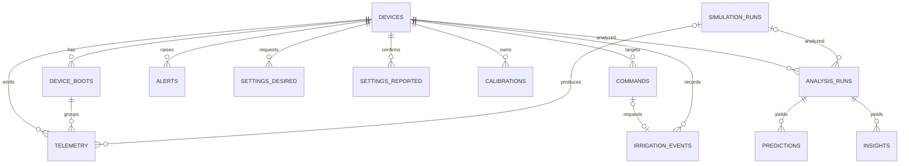

# SQLite model and consistency review

Status: **accepted logical schema specification only**. No SQL migration has been created. Draft §5 is the starting entity list; user Phase 00 Finalization v2 adds the analytics tables. SQLite requires `PRAGMA foreign_keys=ON` on **each connection** for FK enforcement; its `CHECK` constraints accept NULL expressions, so required columns also need `NOT NULL` and explicit null logic. See [SQLite foreign keys](https://www.sqlite.org/foreignkeys.html) and [CREATE TABLE constraints](https://www.sqlite.org/lang_createtable.html). Physical and simulated data must never be merged under one identity.

## Proposed logical relationships

The draft's `device_settings` table conflates desired and effective local settings. Split it into desired and reported snapshots (or equivalent versioned records); the UI must display which is effective. `calibrations` likewise represent reported device calibration with an explicit revision, status and provenance. A physical calibration is not made valid by editing a server row.

| Entity | Required keys / constraints | Consistency rule |
|---|---|---|
| `devices` | `id` nonempty PK; `identity_kind` physical/simulator; timestamps UTC | Display name is editable, identity and kind are immutable. `last_seen_at` is derived from validated ingestion, never from `sentAt`. |
| `device_boots` | composite PK `(device_id,boot_id)`, FK device; `first_seen_at` required, `device_started_at` nullable | Boot may first appear via telemetry/event. Do not fabricate a wall-clock start from uptime if no trusted time. |
| `telemetry` | FK `(device_id,boot_id)` to boots; `UNIQUE(device_id,boot_id,seq,topic)`; topic fixed `telemetry`; NOT NULL received time/source/qualities/mode/state/pump flag | Use device time only if valid; otherwise `measured_at=NULL`. Percent NULL unless quality supports numeric value. Physical device rows cannot have simulator source. Sequence gaps are allowed and shown. |
| `commands` | `id` UUID PK; device FK; JSON payload validated before insert; created/expires UTC; status enum; target boot FK or stored target boot | Insert before publish. Terminal `completed/rejected/failed` never regress; ACK and event correlation must be transactional. `unknown` is a backend observation, not proof of actuation. |
| `command_acks` | `UNIQUE(device_id,boot_id,seq,topic)` and FK command where recognized | Preserve all validated ACK observations, including duplicate/late audit, while canonical command status follows monotonic transition rule. |
| `irrigation_events` | `event_key` unique; FK device and optional command; `pulse_id` unique per device/boot for a pulse summary; nonnegative durations | `actual_ms` is only known on end; start/end correlation cannot create two pulse summaries. `trigger_source` and `source` agree with identity. |
| `alerts` | FK device; code/severity enums; opened_at required; resolved_at >= opened_at | At most one active alert for `(device_id,code)` via partial unique index where unresolved. Resolve on explicit recovery evidence, not mere connectivity. |
| `settings_desired` / `settings_reported` | device FK; positive revision; complete validated values; unique `(device_id,revision)` in history or single latest row | Desired can be pending/rejected; reported is authoritative for displayed effective settings. Reject lower revisions. Store received and device timestamps separately. |
| `calibrations` | PK `(device_id,kind)` or revision history; `kind` soil/tank; positive revision; endpoint pair checks | Soil dry/wet raw must differ by minimum validated span; tank empty/full distances must be ordered per geometry. Null pair means uncalibrated, never valid. |
| `simulation_runs` | run ID PK, seed, scenario/version, start time, virtual-clock policy | Every simulated row links to a run; simulation cannot share physical identity/topic. |

Use SQLite `STRICT` tables if the chosen bundled SQLite version supports them, explicit `NOT NULL`, `CHECK` for 0–100 percentages, positive intervals/budgets, integer booleans 0/1, enumerated states/qualities, and composite foreign keys. Threshold constraint: `0 <= dry_threshold_percent < wet_threshold_percent <= 100`. Durations must be positive and below a firmware hard cap. `tank_min_percent` is 0–100. Store UTC timestamps in one canonical format; state that `received_at` is server time, not measurement time. Add `time_trusted NOT NULL CHECK(time_trusted IN (0,1))` to telemetry and enforce `(time_trusted=1 AND measured_at IS NOT NULL) OR (time_trusted=0 AND measured_at IS NULL)`. For soil, derive `measured_at = sentAt - (uptimeMs-soilAcquiredUptimeMs)` only when `timeTrusted=true`, acquisition uptime is valid and the device clock has not jumped; otherwise keep it NULL. Tank acquisition time should be stored separately by the same rule. Never use packet publication or receipt time as the soil sample's timestamp. Keep raw ADC plus `soil_calibration_revision` and `tank_calibration_revision` with telemetry so interpretation can be audited after recalibration. Add `settings_revision` to telemetry/events where it affects behavior.

The draft index set is useful. Add unique event identity and indexes for `(device_id,boot_id,seq)`, commands `(device_id,created_at DESC)`, ACK lookup by command, and a partial active-alert index. Verify query plans only once implementation exists. SQLite transaction boundaries: (a) valid message dedup insert plus boot/device last-seen update; (b) command creation plus durable publish intent (outbox) so API crash cannot silently lose a request; (c) ACK insert plus canonical status advance; (d) event correlation plus alert updates. MQTT publish itself is outside SQLite transaction, so an outbox publisher may resend the **same** command ID; device idempotency is mandatory.

## Ingestion and reconciliation rules

1. Authenticate MQTT principal and match it to topic identity, then validate schema/version and source before any database write. Invalid payloads go to bounded diagnostics, never into measurements or control state.
2. `INSERT OR IGNORE`-style dedup must compare the stored payload hash on collision. An identical retransmission is harmless; same identity/sequence with different content is an integrity alert, not an overwrite.
3. Receipt order can differ from device sequence order; do not use `MAX(seq)` to reject late valid events. `bootId` partitions sequence. A duplicate after 30-day telemetry purge may reappear: retain a compact dedup watermark/ledger or constrain the replay window and document this tradeoff before retention is implemented.
4. A terminal command status advances only through an allowed transition. A `completed` ACK requires a correlated pulse end record or marks it `completed_unverified` until event reconciliation; UI must show the distinction. The device report remains authoritative for physical outcome, with hardware caveat.
5. Desired revision is never displayed as applied until matching reported revision and values arrive. On reconnect, compare reported revision to desired and flag mismatch; do not silently overwrite device calibration.
6. Raw retention target is 30 days per draft. Define purge frequency, backup/export scope and how simulator rows are cleared separately before implementing retention. Deleting a telemetry row must not erase command or pulse audit needed for the defense demo.

## Analytics tables: logical schema and constraints

The analytics engine in [its design](phase-00-intelligence.md) reads only committed, validated telemetry/events. `analysis_runs` is a parent of predictions and insights. All three tables carry provenance and immutable version metadata; they have no FK or trigger into commands, settings, calibrations or device budget. No analytics table is consulted by the firmware.

| Table | Required columns, nullability, keys and checks | Indexes and lifecycle |
|---|---|---|
| `analysis_runs` | `id TEXT PRIMARY KEY NOT NULL` UUID; `device_id TEXT NOT NULL` FK devices; `simulation_run_id TEXT NULL` FK simulation_runs; `source TEXT NOT NULL CHECK(source IN ('device','simulator'))`; `algorithm_name TEXT NOT NULL`; `algorithm_version TEXT NOT NULL`; `config_hash TEXT NOT NULL` hex digest; `input_start_at`, `input_end_at` UTC NOT NULL with `start<=end`; `input_row_hash TEXT NOT NULL`; `sample_count INTEGER NOT NULL CHECK(sample_count>=0)`; `coverage REAL NULL CHECK(coverage BETWEEN 0 AND 1)`; `executed_at` UTC NOT NULL; `status TEXT NOT NULL CHECK(status IN ('VALID','INSUFFICIENT_DATA','UNRELIABLE_TREND','ERROR'))`; `reason_code TEXT NULL`. Enforce `(source='device' AND simulation_run_id IS NULL) OR (source='simulator' AND simulation_run_id IS NOT NULL)` plus matching device identity kind. | Index `(device_id,executed_at DESC)` and `(simulation_run_id,executed_at DESC)`; unique idempotency key `(device_id,simulation_run_id,algorithm_name,algorithm_version,config_hash,input_row_hash)` with explicit null-safe physical equivalent. Analysis is immutable; rerun with different inputs/config creates new ID. |
| `predictions` | `id TEXT PRIMARY KEY NOT NULL`; `analysis_run_id TEXT NOT NULL` FK analysis_runs; `prediction_type TEXT NOT NULL CHECK(prediction_type='DRY_THRESHOLD_CROSSING')`; `status TEXT NOT NULL CHECK(status IN ('INSUFFICIENT_DATA','UNRELIABLE_TREND','VALID'))`; `estimated_crossing_at TEXT NULL`; `horizon_ms INTEGER NOT NULL CHECK(horizon_ms>0 AND horizon_ms<=86400000)`; `dry_threshold_percent REAL NOT NULL CHECK(dry_threshold_percent>=0 AND dry_threshold_percent<=100)`; `slope_pp_per_hour REAL NULL`; `r_squared REAL NULL CHECK(r_squared>=0 AND r_squared<=1)`; `residual_mad_pp REAL NULL CHECK(residual_mad_pp>=0)`; `training_start_at`, `training_end_at` UTC NULL; `sample_count INTEGER NOT NULL CHECK(sample_count>=0)`; `created_at` UTC NOT NULL; `actual_crossing_at TEXT NULL`; `actual_observed_at TEXT NULL`; `outcome_source TEXT NULL`. `VALID` requires nonnull estimate, slope/fit/training fields; other statuses require `estimated_crossing_at IS NULL`. Actual outcome is a later observation, not overwritten prediction. | Unique `(analysis_run_id,prediction_type)`; index `(analysis_run_id,status)` and `(actual_crossing_at)`; append observation/outcome in a separate audit record if immutable prediction history is required. |
| `insights` | `id TEXT PRIMARY KEY NOT NULL`; `analysis_run_id TEXT NOT NULL` FK analysis_runs; `insight_type TEXT NOT NULL` enum trend/forecast/anomaly/data_quality; `severity TEXT NOT NULL CHECK(severity IN ('info','warning'))`; `evidence_start_at`, `evidence_end_at` UTC NOT NULL ordered; `evidence_summary_json TEXT NOT NULL` validated bounded JSON with point/event IDs and statistics; `explanation_fa TEXT NOT NULL`; `recommendation_fa TEXT NULL`; `created_at` UTC NOT NULL; `status TEXT NOT NULL CHECK(status IN ('active','superseded','dismissed'))`; `algorithm_version TEXT NOT NULL`. | Index `(analysis_run_id,created_at DESC)` and `(status,created_at DESC)`; source is inherited from analysis run and exposed by API. Dismissal affects presentation only, never safety. |

Logical check notation above is a migration specification, not SQL to execute. For `analysis_runs` idempotency, use one partial unique key on `(device_id,algorithm_name,algorithm_version,config_hash,input_row_hash)` where `source='device'` and a separate one on `(simulation_run_id,device_id,algorithm_name,algorithm_version,config_hash,input_row_hash)` where `source='simulator'`; this avoids SQLite's distinct-NULL behavior. SQLite CHECK cannot reference another table, so matching `analysis_runs.source` to `devices.identity_kind` and `simulation_runs.device_id` needs a repository transaction or trigger, plus negative tests. JSON fields need application validation and length cap; a syntactically valid JSON blob is not a trusted explanation. Use UTC ISO strings in canonical form; validate time ordering in the repository because lexical comparison requires consistent format. If the selected SQLite version lacks `STRICT`, use explicit application type checks and document the version. A prediction's actual outcome must be sourced from later **physical** telemetry only when its parent run is physical; simulated outcomes remain simulation-labeled.

Analytics retention: preserve run metadata, version/config/input hashes, predictions, insights and evaluation summaries for the university defense. The 30-day raw telemetry target can invalidate the ability to recompute an old analysis; export the exact input fixture or mark the run `nonreproducible_after_purge` before deletion. Never silently pretend an old result can be recalculated. Delete a simulation run and its analysis children together only through an explicit source-scoped cleanup; never cascade deletion of physical audit data. Retention duration and backup location are deployment configuration to pin before implementation.

## Data tests to specify for Phase 02/03

Test each CHECK/FK/UNIQUE rule with one valid and one invalid row, FK enforcement on every connection, duplicate-identical versus duplicate-conflicting telemetry, out-of-order event arrival, repeated ACK, terminal-status regression, API crash between insert/publish, restart/replay with same command ID, reported/desired mismatch, 30-day purge plus replay, and physical/simulated isolation. No such tests have run in Phase 00.

For analytics, also test null-safe uniqueness for physical runs, mismatched source/run identity, invalid `VALID` prediction with null crossing, out-of-range fit/horizon, explanation without evidence, later outcome with wrong provenance, old analysis after raw-data purge, and that analytics repositories have no command/settings write capability. These remain future tests.
