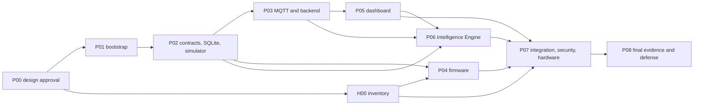

# Phase 00 decisions, acceptance and implementation plan

Status: **Phase 00 design baseline; future execution plan only**. The user accepted ADR-01–08 and ADR-12–19 in Phase 00 Finalization v2. Hardware ADR-09/10 remain `OPEN_HARDWARE`. No task below has been executed and none authorizes the next phase.

## ADR register

| ADR | Decision and state | Rationale / consequence | Later gate |
|---|---|---|---|
| ADR-01 | **ACCEPTED:** ESP32 alone authorizes pump actuation/safety. | Local control remains independent of laptop and analytics. | Verify P04/P07. |
| ADR-02 | **ACCEPTED:** MQTT 3.1.1; clean device session; commands non-retained; QoS 1 for command/ACK/event; application idempotency. | Prevents offline queued actuation; handles redelivery. | Contract tests P02/P03. |
| ADR-03 | **ACCEPTED:** remote actuation needs trusted UTC, valid 10 s expiry and matching `targetBootId`; reject when time untrusted. | Resolves unsynchronized-clock expiry contradiction. | P03/P04 negative tests. |
| ADR-04 | **ACCEPTED:** persist command reservation before gate ON; never resume interrupted command. | At-most-one commanded pulse across reset, possibly no pulse. | P04 crash tests/flash endurance. |
| ADR-05 | **ACCEPTED:** persistent conservative rolling 24 h runtime budget; reboot/untrusted time does not replenish. | Avoids reset bypass; exact accounting specified in [safety policy](phase-00-safety-hardware.md). | P04 fault injection. |
| ADR-06 | **ACCEPTED:** separate physical/simulated identities, credentials, topics and provenance. | Prevents simulator impersonation. | P02/P07 isolation. |
| ADR-07 | **ACCEPTED:** desired settings separate from reported effective settings. | UI cannot mistake request for applied value. | P02/P03 reconciliation. |
| ADR-08 | **ACCEPTED:** Fastify + Next.js + SQLite + SSE. | Approved university stack; maintain service setup guide. | P01 bootstrap. |
| ADR-09 | **OPEN_HARDWARE:** exact board/pins/sensors/pump/MOSFET/supply/electrical measurements. | Component class does not prove safe wiring. | H00/H05 before pump connection. |
| ADR-10 | **OPEN_HARDWARE:** tank geometry/placement/calibration and safe minimum. | Approximate ultrasound level is geometry dependent. | H02/H03 before real AUTO. |
| ADR-11 | **ACCEPTED_FOR_SIMULATION:** deterministic policy values in [safety design](phase-00-safety-hardware.md#accepted-software-policy); physical suitability unverified. | Enables exact software tests without making plant-care claims. | H07 before real AUTO. |
| ADR-12 | **ACCEPTED:** single-operator authenticated LAN dashboard, server-side sessions and CSRF/origin protection. | Protected command/settings path. | P03/P07 security tests. |
| ADR-13 | **ACCEPTED:** claim only verified software-controlled safety; no physical fault detection claim without hardware. | No flow/current feedback or independent cutoff. | H05–H08 evidence. |
| ADR-14 | **ACCEPTED:** backend Plant Intelligence Engine isolated from firmware control. | Analysis failure cannot affect safe local operation. | P06 isolation tests. |
| ADR-15 | **ACCEPTED:** predictions/insights advisory only; no direct actuation or guard bypass. | Maintains physical authority. | P06 zero-side-effect tests. |
| ADR-16 | **ACCEPTED:** lightweight reproducible TypeScript statistics/ML, no LLM/cloud dependency. | Low cost and academic explainability. | P06 build/evaluation. |
| ADR-17 | **ACCEPTED:** preserve provenance, algorithm/config version, training window and input hash. | Auditable/reproducible results. | P06 data checks. |
| ADR-18 | **ACCEPTED:** abstain on inadequate quality/count/coverage/model validity. | Prevents unsupported forecasts. | P06 negative fixtures. |
| ADR-19 | **ACCEPTED:** time-ordered evaluation against baseline; no future leakage. | Defensible academic comparison. | P06 evaluation report. |

## Acceptance criteria

All criteria below are **specifications for future tests**, not passed tests. Software values follow ADR-11; physical suitability and tank threshold remain OPEN_HARDWARE. Record logs, fixture seed, firmware/build and algorithm versions, measured conditions and operator for each executed result.

| AC | Observable criterion | Evidence method |
|---|---|---|
| AC-01 | At 5 s slots, exactly three distinct fresh calibrated soil samples `<30%` in AUTO with safe tank and commissioned hardware cause one default 2 s pulse, never longer than 3 s, then 60 s SOAKING; max three pulses/cycle. Simulation can set commissioning fixture; real commissioning needs H07. | Fake-clock control test, then H07 wet test. |
| AC-02 | Soil `>=45%` causes zero auto or manual pulses and a reason; 30–<45% alone does not start AUTO. | Boundary tests at 29.99/30/44.99/45%. |
| AC-03 | Unknown/invalid/low tank, `age>=15 s` soil/tank, invalid calibration, exhausted 20 s budget, FAULT or LOCKOUT cause zero starts. Detected tank/soil trip during pulse drives gate OFF within 100 ms in deterministic tests. | Fault injection and later bench trace. |
| AC-04 | Any pulse is cut off by firmware hard timer even with Wi-Fi/broker/API unavailable; pump is OFF at power-up/reset/watchdog. | Fake-clock tests plus oscilloscope/voltage or visible pump evidence at H05/H08. |
| AC-05 | Duplicate command ID, including replay after reconnect and reboot, causes at most one gate ON interval. Crash at every reservation/actuation boundary never causes an extra interval. | Persistent-ledger fault-injection tests; physical spot check. |
| AC-06 | Remote commands with UTC outside `[createdAt,createdAt+10 s)`, wrong boot, MQTT retain, malformed payload or untrusted clock are rejected with reason; no offline queued command actuates on reconnect. | MQTT integration tests using broker and fake clock. |
| AC-07 | Command UI distinguishes queued/published/accepted/completed/rejected/failed/unknown. `accepted` is never shown as watered. Lost ACK yields unknown until reconciled. | API and UI integration trace. |
| AC-08 | Desired settings revision only becomes effective/displayed as applied after reported match; invalid revision rejected without changing local values. | Contract and restart tests. |
| AC-09 | Telemetry/events/ACK duplicate ingestion produces one logical record; conflicting same-key payload raises integrity alert; sequence gaps do not create invented measurements. | SQLite/API tests. |
| AC-10 | Simulation with fixed seed, scenario version and virtual-clock schedule yields byte-identical canonical output; a different seed produces a documented variation. Simulated rows and topics are visibly separate from physical ones. | Repeat simulation twice and compare hashes; UI review. |
| AC-11 | Dashboard shows latest soil/tank quality, pump/state, connection age and historical trends in Persian RTL on phone and desktop. It marks stale at `>=30 s`, and separates device time from receipt time. | UI checks with fixture data. |
| AC-12 | An unauthenticated API request cannot create a command or change settings; wrong MQTT principal cannot publish device telemetry/commands; secrets absent from repository. | Negative auth/ACL tests and repository scan. |
| AC-13 | H00–H08 checklist documents exact parts, voltages/current, calibration, off-on-reset, dry electronics isolation and supervised water test. Hardware-dependent results stay OPEN until signed evidence exists. | Bench records and defense package. |
| AC-14 | Analytics reads only validated persisted rows; untrusted timestamps, invalid/stale/duplicate rows, mixed source and watering discontinuities are excluded. With <12 samples, <60 min span, <80% coverage or >15 min gap, crossing is null and status `INSUFFICIENT_DATA`. | Repository fixtures and quality-gate tests. |
| AC-15 | A stable negative segment that passes slope/fit/horizon gates yields `VALID` crossing with version/window/count/fit/provenance. Flat, increasing, noisy or out-of-horizon segments yield `UNRELIABLE_TREND` and null crossing. | Deterministic model fixtures and boundary cases. |
| AC-16 | MAD=0 and IQR=0 anomaly windows do not divide by zero; candidate jump/stuck/rapid-dry/weak-response flags include type, evidence, threshold, version and source; no flag claims confirmed hardware failure. | Eight-scenario simulation matrix and API/UI review. |
| AC-17 | Analytics module has no command/settings/budget write or MQTT publish path; an analytics crash leaves ESP32 local safety and authenticated manual path behavior unchanged. | Dependency/interface test plus failure injection. |
| AC-18 | Time-ordered evaluation compares baseline and linear regression on identical eligible origins; reports counts, abstention, MAE by horizon and observed-crossing error separately for simulation/physical data, with no future rows in training. No numeric result is claimed before execution. | Reproducible evaluation script and input-hash audit in P06. |

## Dependency map

Safety-critical P04 order: exact board/pin proof and mockable HAL → calibrated sensing → persistent settings/budget/command ledger → gate/cutoff and state machine → MQTT → supervised pump bench test. H05 requires H00; real AUTO requires H02/H03/H05/H07. P06 consumes validated persisted data and can be built with simulation before hardware, but no physical accuracy claim follows from that.

## Implementation-ready task specifications (future; do not execute now)

For **every** row, the listed dependency and input must be present before work; deliverable must include changed-file list, actual verification output and risk note. `PASS` requires every listed acceptance check with recorded evidence; `PARTIAL` means deliverable exists but at least one check or required evidence is missing; `FAIL` means a safety/identity/contract invariant is violated or the deliverable cannot run. `H` means physical part/evidence dependency; `—` means software-only. **Explicit stop gate for each row:** stop after reporting its result and await authorization for the next task/phase; never silently continue. Hardware tasks require operator sign-off and retain OPEN status until evidence exists. Future tasks may refine filenames within the approved monorepo without changing their outputs.

| Task | Dependencies and inputs | Deliverable and acceptance criterion | Verification | H |
|---|---|---|---|---|
| P01-S01 | P00; approved stack | Monorepo/version manifest; clean install, lint/typecheck commands work | automated fresh-host | — |
| P01-S02 | P00; MQTT ACL matrix | Mosquitto local config/credentials; allowed/denied matrix exact | manual + automated broker | — |
| P01-S03 | P01-S01; PRD | Fastify/Next shell and health; fresh start and Persian RTL smoke | automated + browser | — |
| P01-S04 | P01-S01,H00; exact board | Minimal ESP-IDF build/flash without pump; serial evidence | build + manual | H |
| P01-S05 | P01-S01–04 where available | CI workflow and pinned tools; clean runner reproduces checks | automated | H for firmware flash only |
| P02-S01 | P01-S01; contract doc | JSON Schemas/TS types/negative fixtures; valid/invalid packets classified as specified | automated | — |
| P02-S02 | P02-S01; data doc | SQLite migrations/repositories; FK/CHECK/UNIQUE and transactions enforced | automated | — |
| P02-S03 | P02-S01; intelligence matrix | Virtual-clock simulator eight scenarios; same seed gives same canonical hash | automated | — |
| P02-S04 | P02-S02–03 | Seed/export fixture with provenance; no physical/sim identity collision | automated | — |
| P02-S05 | P02-S01–04 | Contract/DB/simulator suite; all negative/replay cases recorded | automated | — |
| P03-S01 | P02; MQTT contract | Consumer with schema/identity/dedup; conflict raises alert, duplicate no-op | broker integration | — |
| P03-S02 | P03-S01; command lifecycle | Authenticated command API/outbox/ACK state; crash/retry never creates new ID | automated fault injection | — |
| P03-S03 | P03-S01; status contract | LWT/heartbeat/reconnect; stale at 30 s and fresh republish | broker fake-clock | — |
| P03-S04 | P03-S01; API | SSE snapshot/cursor; reconnect preserves state without duplicate action | automated/browser | — |
| P03-S05 | P03-S02; ADR-12 | Session, CSRF/origin, ACL negative checks; unauthorized writes denied | automated security | — |
| P04-S01 | P01-S04,H00; pin proof | Pin manifest and fakeable HAL; gate OFF at boot in bench setup | build + bench | H |
| P04-S02 | P04-S01,H02 | Soil ADC/filter/calibration; dry/wet/invalid measured span documented | unit + bench | H |
| P04-S03 | P04-S01,H03 | SRF05 timeout/median/calibration; valid/unknown behavior documented | unit + bench | H |
| P04-S04 | P04-S01,H04 | OLED/button/LED; debounce and fault display verified | unit + bench | H |
| P04-S05 | P04-S02–03,H05; safety doc | Persistent ledger/budget/gate/state machine; cutoff, reboot and 100 ms tests | fault injection + bench | H |
| P04-S06 | P04-S05,P02-S01 | MQTT/reconnect/ACK/settings; no old command replay | broker integration | H for device |
| P04-S07 | P04-S01–06 | Versioned firmware artifact/logs; all safety assertions recorded | build + unit + bench | H |
| P05-S01 | P01-S03,P03-S04 | RTL shell/device summary; mobile/desktop and stale state correct | browser | — |
| P05-S02 | P05-S01,P02-S02 | Real-time/history charts; gaps/quality/source explicit | browser fixture | — |
| P05-S03 | P05-S01,P03-S02 | Manual command panel; accepted distinct from completed | browser/API | — |
| P05-S04 | P05-S01,P03-S02 | Settings/calibration view; desired vs reported and commissioning clear | browser/API | — |
| P05-S05 | P05-S01–04 | Alert/history responsiveness; Persian RTL and negative states checked | browser/accessibility | — |
| P06-S01 | P02-S02,P03-S01; intelligence doc | Versioned analytics contracts/repositories; FK/source checks | automated DB | — |
| P06-S02 | P06-S01 | Validated-history selector/quality gates; invalid/time-unknown excluded | automated fixtures | — |
| P06-S03 | P06-S02 | Rolling statistics and last-rate baseline; exact units/windows | math fixtures | — |
| P06-S04 | P06-S03 | OLS forecast and abstention lifecycle; no cross-pulse fit | math/negative fixtures | — |
| P06-S05 | P06-S02–04 | MAD anomaly candidates/fallback; no zero-scale failure | eight-scenario fixtures | — |
| P06-S06 | P06-S04–05 | Persian insight templates/API; evidence and no control side effects | API/permission tests | — |
| P06-S07 | P06-S06,P05-S05 | Advisory dashboard cards; status/provenance/version visible | browser fixture | — |
| P06-S08 | P06-S03–07,P02-S03 | Time-ordered baseline comparison/evidence; counts, MAE, crossing error, abstention | repeat evaluation | — |
| P07-S01 | P02–P06 | Simulated end-to-end flow; all eight scenarios and source labels | automated demo | — |
| P07-S02 | P03-S05,P06-S06 | Auth/ACL/secrets and analytics isolation; negative matrix passes | automated/manual | — |
| P07-S03 | P03,P04 | Duplicate/reconnect/offline/crash checks; no unsafe pulse | fault injection + bench | H |
| P07-S04 | H05–H07,P04 | Supervised dry/wet bench tests; measured off-on-reset and calibration | manual signed | H |
| P07-S05 | P07-S01–04 | Defect/evidence report; each AC PASS/PARTIAL/FAIL with actual output | review | H |
| P08-S01 | H08,P07 | Exact BOM/wiring with measured ratings and photos | manual review | H |
| P08-S02 | P07-S05 | Setup/recovery manual; another operator repeats installation | manual replay | H for full setup |
| P08-S03 | P06-S08,P07-S05 | Architecture/evaluation report; source and limitations explicit | review | — |
| P08-S04 | P08-S01–03 | Defense script/slides outline; simulation and physical evidence distinguished | rehearsal | H for hardware demo |
| P08-S05 | P08-S01–04,H08 | Final gate; no unresolved safety-critical test failure | signed review | H |

## Separate hardware track

The student/operator owns physical execution. Each task follows the same PASS/PARTIAL/FAIL and explicit stop rules above. No hardware task has run.

| Task | Dependencies/input | Deliverable and acceptance | Verification |
|---|---|---|---|
| H00 | Parts in hand | Exact board/part IDs, pins, supply/pump ratings and voltage measurements; no unsafe GPIO exposure | measured, signed |
| H01 | H00 | ESP32 flashes, serial/connection stable with pump absent | measured, signed |
| H02 | H01 | Soil dry/wet raw span, polarity and 3.3 V-safe output recorded | measured, signed |
| H03 | H01 | SRF05 Echo shifted, geometry and empty/full distance calibrated | measured, signed |
| H04 | H01 | OLED variant/address and button/LED currents verified | measured, signed |
| H05 | H00,H01 | Pump/MOSFET separately bench-tested; gate pulldown, flyback, OFF-on-reset verified | measured, signed |
| H06 | H02–H05 | Real-device MQTT identity/telemetry/ACKs verified; no simulator confusion | logs, signed |
| H07 | H06 | Supervised watering/low tank/fault/offline recovery with water isolated from electronics; commissioning decision | measured/video, signed |
| H08 | H07 | Final hardware checklist with defects closed or explicitly accepted | signed review |

## Phase 00 approval boundary

ADR-01–08 and ADR-12–19 are accepted by the user's Phase 00 Finalization v2; ADR-11 is accepted only for simulation/software policy. ADR-09/10 remain OPEN_HARDWARE and block their dependent physical work, not approval of software bootstrap. The [final summary](phase-00-final-summary.md) records the Phase 00 gate. **No Phase 01 work has started; explicit user approval is required.**
