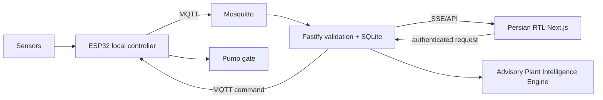

# Smart Irrigation IoT — Phase 00 product requirements

Version 2, 2026-11-06. Status: **design baseline for approval; no implementation or physical validation**. This document refines the [authoritative draft](/home/alireza/Desktop/smart-irrigation-phase-00.md) with the user's Phase 00 Finalization v2. The latter explicitly adds lightweight analytics, superseding the draft's earlier “ML out of scope” clause. Detailed contracts, policy, data rules and test criteria are linked below.

## Product goal and users

One student/operator monitors and safely irrigates one plant from an ESP32 on a protected local LAN. The system demonstrates a complete, reproducible IoT path: physical sensing → local control → MQTT → validated SQLite history → Persian RTL dashboard → advisory analytics. The device remains safe and locally autonomous when the laptop, broker or Wi-Fi is absent. Low part cost, understandable methods and an honest distinction between simulation and hardware evidence are requirements.

## User scenarios

| Scenario | Required observable behavior |
|---|---|
| Observe plant | Show calibrated soil percentage, approximate tank percentage, quality, age, pump state, and historical chart; never render missing as zero. |
| Automatic dry response | After three fresh consecutive samples below 30% in AUTO and all guards pass, execute one bounded 2 s pulse, then 60 s soak and reassessment. Unsupervised real AUTO is disabled until physical calibration and supervised test sign-off; H07 uses local supervised commissioning mode. |
| Manual request | Button or authenticated web user requests a pulse; both use the same device safety guards. UI distinguishes request, acceptance and actual completion. |
| Unsafe conditions | Low/unknown tank, invalid calibration/sensor, wet soil, depleted budget or fault blocks a start with a reason. Sensor loss or hard timeout during watering de-energizes the commanded gate. |
| Connectivity loss | ESP32 local control continues within its safety limits; dashboard marks stale after 30 s without fresh device evidence. Reconnect synchronizes reported state; old commands do not actuate. |
| Analyze history | Dashboard shows rolling trend, a dry-threshold forecast only when valid, and explainable anomaly/insight cards with evidence and source label. Invalid or insufficient data yields abstention. |
| Academic defense | Reproduce deterministic scenarios, export versions/seeds/logs, compare forecast to baseline on time-ordered data, and keep simulated results separate from real observations. |

## Functional requirements

| ID | Requirement |
|---|---|
| FR-01 | Sample and filter ADC soil readings; persist dry/wet calibration and its revision; label invalid/uncalibrated/stale quality. |
| FR-02 | Time out and filter SRF05 readings; calibrate empty/full distance and show approximate tank percentage or unknown. |
| FR-03 | ESP32 alone owns IDLE/WATERING/SOAKING/LOCKOUT/FAULT and pump gate; all starts share the [safety policy](phase-00-safety-hardware.md). |
| FR-04 | AUTO uses dry/wet hysteresis, consecutive readings, bounded pulses, soak, cycle cap and persistent rolling runtime budget. |
| FR-05 | Button and authenticated dashboard manual paths obey all guards; remote requests require trusted UTC, matching boot and valid 10 s expiry. |
| FR-06 | OLED and LED expose soil/tank/pump/connectivity and fault state; exact display and electrical variant remain hardware OPEN. |
| FR-07 | MQTT telemetry/status/events/commands/ACKs/settings use the [v1 contract](phase-00-contracts.md), identity isolation and deduplication. |
| FR-08 | Backend validates and persists data; SSE streams snapshots/updates; dashboard shows trends, settings reconciliation, alerts and command outcomes. |
| FR-09 | Seeded simulator with virtual clock produces repeatable scenarios and source labels, never impersonating the physical device. |
| FR-10 | Installation, wiring, test evidence and defense guide identify executed versus planned tests. |
| FR-11 | Backend Plant Intelligence Engine consumes **validated persisted** telemetry/events; computes rolling moisture statistics and drying rate, with data coverage/quality. |
| FR-12 | Engine may forecast dry-threshold crossing using versioned linear regression only after quality gates; otherwise returns `INSUFFICIENT_DATA` or `UNRELIABLE_TREND`. |
| FR-13 | Engine detects candidate jumps, rapid drying, stuck readings and weak post-watering response with robust statistics; outputs explain uncertainty and are not diagnoses. |
| FR-14 | Persian insight cards show status, evidence window, algorithm version and physical/simulated provenance. Analytics never publish commands, change safety settings or clear faults. |
| FR-15 | Academic evaluation uses time-ordered train/test and rolling origins where feasible; compares candidate to a specified baseline and reports eligible cases, MAE, crossing error, abstention and limitations without invented metrics. |

## Nonfunctional requirements and architecture

- LAN-only MVP; single authenticated operator; server-side sessions and CSRF/origin checks on command/settings routes; separate MQTT users and ACLs; no committed secrets. The LAN is a deployment trust boundary, not a claim of confidentiality against a hostile LAN participant.
- ESP-IDF on ESP32-WROOM-32 DevKit; MQTT 3.1.1/Mosquitto; Node.js/TypeScript/Fastify and SQLite; Next.js/Tailwind Persian RTL dashboard with SSE; deterministic TypeScript simulator and backend analytics. Pin exact versions at bootstrap.
- No mains switching. Gate defaults OFF through external pulldown; bounded commanded runtime independent of network; local safety does not depend on analytics. A stuck-on electrical driver cannot be ruled out by firmware alone.
- Every observation distinguishes device measurement time, server receipt time and source. A null/untrusted measurement time is not silently replaced with receipt time for forecasting.
- Common control defaults are in [safety policy](phase-00-safety-hardware.md#accepted-software-policy). They are **software/simulator test values, not plant-care advice or physically validated limits**.

The analytics module reads committed history. It has no MQTT publisher, firmware control channel or write path to commands/settings/budgets; its recommendations remain advisory. [Intelligence design](phase-00-intelligence.md) defines its input/output and evaluation.

## MVP exclusions

Multiple plants/users, weather prediction, autonomous AI-driven actuation, cloud/paid AI, LLM APIs, Python service, vector database, OTA, public Internet access, native mobile app and true volumetric water metering are excluded. Physical fault detection for a shorted MOSFET, empty line, leak or failed pump is not claimed without instrumentation.

## Measurable acceptance and academic gate

The [acceptance matrix](phase-00-plan.md#acceptance-criteria) defines control, MQTT, storage, UI, simulation, analytics and security assertions with evidence methods. In particular: a valid three-sample dry sequence permits one bounded pulse; wet/unknown/invalid cases permit none; duplicate command IDs never create a second pulse; status becomes stale after 30 s; a fixed simulation seed yields byte-identical canonical output; analytics abstains on inadequate quality and never emits control side effects. These are future tests, not passed results. Time-ordered forecast evaluation must report baseline and candidate outcomes with case counts and provenance, including negative results. Hardware H00–H08 remains a separate signed evidence track.
