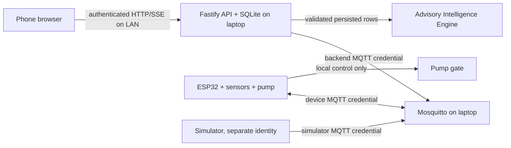

# Smart Irrigation IoT — Phase 00 design review

Date: 2026-11-06. Status: **Phase 00 design review finalized; Phase 01 awaits explicit approval**. Sources of product intent: [draft specification](/home/alireza/Desktop/smart-irrigation-phase-00.md), version 0.1, and the user's Phase 00 Finalization v2. The latter explicitly accepts ADRs, software defaults and an advisory analytics module, superseding the draft's “ML out of scope” clause. No application code, migration, device build, simulation run, model training or hardware test was performed.

## Gate summary

| Check | Result | Evidence and required resolution |
|---|---|---|
| PRD completeness/feasibility | PASS | [PRD](phase-00-prd.md) fixes single-plant scope, stack, exclusions, analytics boundary and user scenarios. Physical feasibility remains separately OPEN_HARDWARE. |
| PRD testability | PASS | [Acceptance matrix](phase-00-plan.md#acceptance-criteria) gives numeric/default boundary assertions and evidence methods; no test execution is implied. |
| Architecture and trust boundary | PASS | [PRD flow](phase-00-prd.md#nonfunctional-requirements-and-architecture), diagram below and accepted ADR-01/08/12/14/15 define components, data path, auth and advisory isolation. |
| Firmware state machine design | PASS | [Safety policy](phase-00-safety-hardware.md) defines timer boundaries, common guards, transitions, priorities, reset/lockout/fault handling and commissioning flag. |
| Physical safety validation | PARTIAL | Default-off and cutoff rules are specified, but exact pump/driver/supply and OFF-on-reset measurements are OPEN_HARDWARE; software cannot prove a shorted MOSFET is off. |
| MQTT topics, QoS, retain and schemas | PASS | [Contract](phase-00-contracts.md) defines topic writers, schemas/units, LWT, identities, reason registry and valid/invalid examples. Executable JSON Schema is planned P02, outside Phase 00. |
| ACK lifecycle and duplicates | PASS | [Command transaction](phase-00-contracts.md#command-transaction) defines boot/time binding, durable reservation, terminal progression, crash reconciliation and no second pulse. |
| SQLite logical model | PASS | [Data review](phase-00-data.md) specifies entities, provenance, FKs, checks, uniqueness, transactions and three analytics tables. Migrations are P02 work. |
| Hardware/software compatibility | PARTIAL | GPIO34/ADC1 and avoiding ADC2 with Wi-Fi are supported by [Espressif](https://docs.espressif.com/projects/esp-idf/en/v5.5/esp32/api-reference/peripherals/gpio.html); SRF05 is a 5 V device per [manufacturer](https://www.robot-electronics.co.uk/products/sensors/ultrasonics/srf05.html). Exact parts and measurements remain OPEN_HARDWARE. |
| Deterministic simulation design | PASS | [Intelligence matrix](phase-00-intelligence.md#deterministic-simulation-matrix-unexecuted) and P02 task specify seed, virtual clock, eight scenarios, canonical hash and provenance. |
| Analytics design/testability | PASS | [Intelligence design](phase-00-intelligence.md) defines OLS/MAD, quality gates, abstention, baseline, time-ordered evaluation and zero-control boundary. No accuracy result is claimed. |
| Security design | PASS | ADR-12 plus [contract ACL](phase-00-contracts.md#topic-and-identity-rules) and threat cases below define authenticated LAN path, sessions, CSRF/origin and negative tests. |
| Implementation/hardware test execution | PARTIAL | Deliberately unexecuted in Phase 00. AC-01–18 and H00–H08 are planned evidence gates, not passed results. |
| Phase 00 documentation deliverables | PASS | Eight `docs/` files contain PRD, review, contracts, safety, data, intelligence, ADRs/tasks and final summary; documentation consistency is checked separately. |

**Overall Phase 00 design gate: PASS**, subject to documentation consistency checks recorded in the [final summary](phase-00-final-summary.md). PASS means the design is specified and testable; it does **not** mean implementation, model, electrical or wet tests passed. ADR-09/10 remain OPEN_HARDWARE and block their dependent physical work. Phase 01 still requires explicit user approval.

## Proposed runtime boundary and threats

The ESP32 continues local sampling/control when the laptop, broker or Wi-Fi fails; the dashboard then shows stale state. Browser traffic terminates at the API, with no broker password exposed to the browser. The API is the single command issuer; analytics has no control publisher. Broker ACL constrains each namespace. Threat cases to test: unauthorized LAN pulse, stolen MQTT credential, replay/delay, spoofed simulator telemetry, malformed oversized payload, stale retained status, broker restart, laptop crash between persistence and publish, and physical access to button/wiring. The draft's LAN-only and no-TLS MVP choice means Wi-Fi/LAN trust is an explicit deployment assumption; document WPA-protected demo network and do not claim confidentiality against a LAN attacker. ADR-12 is accepted; exact host OS/deployment packaging remains a P01 setup choice.

## Findings disposition

| ID | Original finding | Disposition | Evidence / remaining boundary |
|---|---|---|---|
| R-01 | UTC command expiry without RTC/NTP | RESOLVED | ADR-03: reject remote actuation unless UTC trusted; boot match and 10 s expiry. |
| R-02 | QoS 1 duplicate/reboot pulse | RESOLVED IN DESIGN | ADR-04 durable reservation before gate ON, no resume, safe eviction/expiry; execution tests P04/P07. |
| R-03 | LWT cannot supply live sequence/uptime | RESOLVED | Status-specific schema with preconfigured offline will and nullable timestamp; [contract](phase-00-contracts.md#status-ack-and-reason-registries). |
| R-04 | Daily budget across reboot/untrusted time | RESOLVED IN DESIGN | ADR-05 conservative persistent rolling accounting and undated debt; [safety](phase-00-safety-hardware.md#safety-invariants). |
| R-05 | Manual wet-soil guard missing | RESOLVED | Shared start guard and `>=45%` cutoff for button/web; [policy](phase-00-safety-hardware.md#accepted-software-policy). |
| R-06 | FAULT/LOCKOUT reset undefined | RESOLVED | Latching fault and explicit lockout recovery in [safety](phase-00-safety-hardware.md#transition-table). |
| R-07 | Desired/effective settings conflated | RESOLVED | ADR-07 and separate desired/reported state in [data](phase-00-data.md). |
| R-08 | Simulator could appear physical | RESOLVED | ADR-06 separate namespace/principal/run provenance. |
| R-09 | Broad physical fail-safe claim unsupported | CONSTRAINED | ADR-13 limits claims to verified software control; stuck driver/leak remains physical residual risk pending H05–H08. |
| R-10 | Exact electrical parts unknown | OPEN_HARDWARE | ADR-09/10 require H00–H08; no measurements invented. |
| R-11 | Stack complexity choice | RESOLVED | ADR-08 accepts Fastify/Next.js/SQLite/SSE; setup burden remains a maintainability risk. |
| R-12 | Device and server times conflated | RESOLVED | Store `measured_at` only with trusted device time; `received_at` separate; analytics abstains otherwise. |
| R-13 | Draft excluded ML but v2 requires analytics | RESOLVED | User v2 supersedes that exclusion; advisory TypeScript engine and no control side effects under ADR-14–19. |

## Review boundaries and evidence

The draft is the source for intended behavior. Primary technical references used here: [ESP-IDF MQTT v5.5.2](https://docs.espressif.com/projects/esp-idf/en/v5.5.2/esp32/api-reference/protocols/mqtt.html), [ESP32 GPIO restrictions](https://docs.espressif.com/projects/esp-idf/en/v5.5/esp32/api-reference/peripherals/gpio.html), [ESP32-WROOM-32 electrical data](https://documentation.espressif.com/esp32-wroom-32_datasheet_en.html), [SRF05 manufacturer](https://www.robot-electronics.co.uk/htm/srf05tech.htm), [Mosquitto configuration](https://www.mosquitto.org/man/mosquitto-conf-5.html), [SQLite foreign keys](https://www.sqlite.org/foreignkeys.html) and [SQLite constraints](https://www.sqlite.org/lang_createtable.html). These support design feasibility, not actual hardware compatibility or test results.
